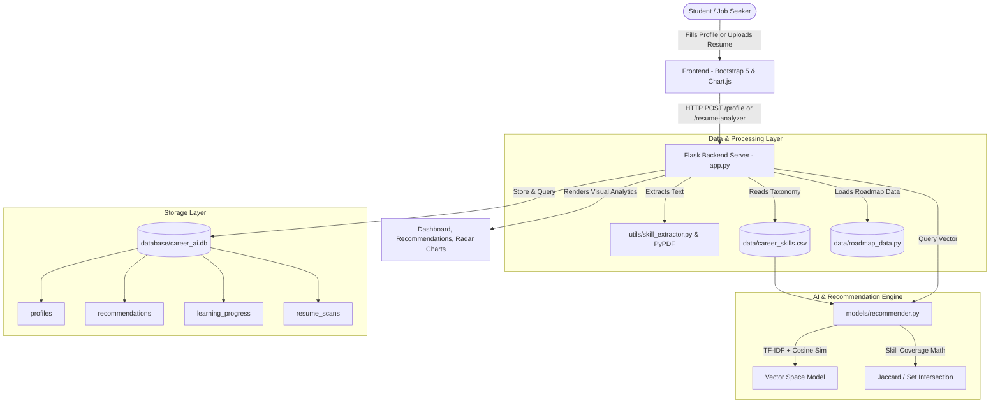

# CareerAI — AI Career Recommendation & Skill Gap Analyser

> **"Discover Your Potential. Build Your Future."**


A modern, responsive full-stack web application designed for students, computer applications (BCA/MCA) graduates, and career changers. CareerAI evaluates an individual's educational background, technical proficiencies, and career goals to compute top recommended tech careers, diagnose missing skill gaps with priority levels, generate structured 3-tier learning roadmaps with free verified learning resources, and audit uploaded resumes in PDF/TXT format.

---

## Table of Contents
1. [Project Overview](#1-project-overview)
2. [Key Objectives](#2-key-objectives)
3. [Core Features](#3-core-features)
4. [Technology Stack](#4-technology-stack)
5. [System Architecture](#5-system-architecture)
6. [Recommendation Algorithm Explanation](#6-recommendation-algorithm-explanation)
7. [Dataset Description](#7-dataset-description)
8. [Project Structure](#8-project-structure)
9. [Installation & Local Setup](#9-installation--local-setup)
10. [Step-by-Step Testing Guide](#10-step-by-step-testing-guide)
11. [How to Safely Upload to GitHub](#11-how-to-safely-upload-to-github)
12. [Final-Year BCA Project Report Outline](#12-final-year-bca-project-report-outline)
13. [Future Enhancements](#13-future-enhancements)

---

## 1. Project Overview
Navigating the modern tech landscape is often overwhelming for students and job seekers. Job descriptions list dozens of disparate tools without clarifying which skills are mandatory versus secondary. **CareerAI** solves this challenge by serving as an intelligent career counseling and skill gap analysis system.

By combining Natural Language Processing (TF-IDF Vector Space Modeling and Cosine Similarity) with transparent rule-based skill coverage matrices, CareerAI matches candidates to realistic, in-demand industry roles and charts an actionable path from their current skill level to job-readiness.

---

## 2. Key Objectives
- **Personalized Career Matching:** Recommend the top 3 tech careers best aligned with a candidate's skills, degree, and interests.
- **Transparent Skill Gap Diagnostic:** Compare user skills against industry standards, categorizing gaps into High, Medium, and Low priorities.
- **Actionable 3-Tier Roadmaps:** Provide structured milestones across Beginner, Intermediate, and Advanced stages with verified, legitimate learning resources.
- **Interactive Habit Building:** Track task completions dynamically using a persistent SQLite database checklist.
- **Automated Resume Parsing:** Extract technical and soft skills from PDF or TXT resumes and audit them against specific job roles.

---

## 3. Core Features

### A. Home & Landing Page
- Modern glassmorphism UI with a dark navy (`#070a13`) and purple gradient theme.
- Interactive hero section highlighting platform capabilities and previewing recommendations.
- 4-step workflow breakdown ("Submit Profile" &rarr; "AI Matching" &rarr; "Identify Gaps" &rarr; "Follow Roadmap").
- Domain showcase across 6 high-demand tech sectors.

### B. Student Profile Form
- Captures Full Name, Education Level, Degree/Branch, Programming Languages, Technical Skills, Soft Skills, Experience Level, Domain Preferences, and Dream Career Goal.
- Interactive **Click-to-Add Skill Chips** allowing users to quickly toggle common industry skills.
- **"Load Demo Profile"** button for instant one-click evaluation without tedious manual typing.

### C. AI Career Recommendations
- Generates the top 3 career tracks (e.g., Data Engineer, Data Scientist, Data Analyst, Web Developer, Machine Learning Engineer, Cloud/DevOps Engineer, etc.).
- Transparent Suitability Scores (0% – 100%) with a clear breakdown of:
  - Skill Coverage (50% weight)
  - NLP TF-IDF Semantic Fit (30% weight)
  - Domain & Goal Affinity (20% weight)
- Displays matching skills (green check badges) and missing skills (with priority indicators).
- Visual horizontal comparison bar chart comparing the top recommended careers.

### D. Skill Gap Analysis
- Deep-dive diagnostic comparing the candidate's skills against any selected career role.
- **Competency Radar Chart** mapping candidate readiness across key domain dimensions against the 100% role benchmark.
- Categorized gap table separating **High Priority** (immediate foundational blockers), **Medium Priority** (essential tools), and **Low Priority** (secondary assets).

### E. Personalized 3-Tier Learning Roadmap
- Breaks learning paths into:
  - **Beginner Level:** Core fundamentals, syntax, and foundational terminology.
  - **Intermediate Level:** Design patterns, frameworks, and real-world integrations.
  - **Advanced Level:** Production architecture, scalability, optimization, and security.
- For every milestone: Topic name, Learning objective, Duration, Practice tasks, Mini-project idea, and **100% Free Verified Learning Resources** (official documentation, freeCodeCamp, Kaggle, MDN, DevDocs).
- Interactive checkboxes with asynchronous AJAX persistence to SQLite.

### F. Candidate Analytics Dashboard
- 5 Key Metric Cards: Total Skills Registered, Top Recommended Career, Match Percentage, Missing Target Skills, and Milestones Checked.
- Responsive **Chart.js** data visualizations: Comparative Career Fit (Bar Chart) and Target Skill Gap Ratio (Doughnut Chart).

### G. Resume Skill Analyser
- Upload resumes in **PDF** (via `pypdf`) or **TXT** format (Max size: 5MB).
- Extracts technical and soft skills using regular expression pattern matching against a dictionary of 150+ tech terms.
- Audits resume skills against the chosen target career, displaying matched skills, missing skills, and resume improvement suggestions.
- Automatically removes uploaded files from disk after processing for user privacy.
- Includes a **"Quick Sample Resume Scan"** button for instant testing.

### H. Progress Tracker Page (`/progress-tracker`)
- Dedicated progress tracking dashboard with visual task completion counters (Total, Done, Remaining, %).
- Filter tasks dynamically by "All", "Completed", or "Pending".
- Per-skill progress bars with interactive checkboxes synced in real-time to SQLite via REST API.
- Quick reset progress modal dialog.

### I. About Project Page (`/about`)
- Academic capstone documentation detailing problem statements, objectives, and significance.
- Mathematical formulation breakdown of the multi-dimensional suitability scoring model.
- Complete technology stack matrix and architecture diagrams suitable for final-year BCA viva voce presentations.

---

## 4. Technology Stack

| Layer | Technologies Used | Purpose |
| :--- | :--- | :--- |
| **Frontend** | HTML5, CSS3, JavaScript (ES6+), Bootstrap 5.3 | Responsive dark navy/purple UI with glassmorphism |
| **Data Visualization**| Chart.js 4.4 | Radar charts, grouped bar charts, doughnut charts |
| **Icons & Typography**| Font Awesome 6.5, Google Fonts (Plus Jakarta Sans) | Modern iconography and clean typography |
| **Backend** | Python 3.11+, Flask 3.1, Jinja2, Werkzeug | RESTful routing, session management, file upload safety |
| **Machine Learning** | Scikit-learn, Pure-NumPy Vectorizer Fallback | TF-IDF Vectorization, Cosine Similarity, Skill Coverage |
| **Data Analysis** | Pandas, NumPy, Python CSV Engine | Dataset parsing, matrix multiplication, L2 normalization |
| **Document Processing**| PyPDF 6.2+ | Text extraction from PDF resumes |
| **Database** | SQLite 3 | Relational persistence for profiles, recommendations, checklist progress |

---

## 5. System Architecture



---

## 6. Recommendation Algorithm Explanation

The recommendation system calculates a transparent, deterministic **Suitability Score** between $12.0\%$ and $98.5\%$ to prevent unrealistic 100% claims and random fluctuations:

$$\text{Suitability Score} = \left( 0.50 \times S_{\text{skills}} + 0.30 \times S_{\text{nlp}} + 0.20 \times S_{\text{domain}} \right) \times 100$$

### 1. Skill Coverage Score ($S_{\text{skills}}$ — 50% Weight)
Measures the intersection of the user's validated skills $U$ with the career's required core skills $R$ and secondary skills $S$:
$$S_{\text{skills}} = \min\left(1.0, \frac{|U \cap R|}{|R|} \times 0.85 + \min(0.20, |U \cap S| \times 0.05)\right)$$

### 2. NLP Semantic Fit ($S_{\text{nlp}}$ — 30% Weight)
The candidate profile (skills, education, degree, goal, interests) is converted into a TF-IDF term vector $\vec{u}$. Each career's comprehensive description, required toolchain, and soft skills form a document vector $\vec{c}_i$. The semantic similarity is calculated using Cosine Similarity:
$$\text{Cosine Similarity}(\vec{u}, \vec{c}_i) = \frac{\vec{u} \cdot \vec{c}_i}{\|\vec{u}\|_2 \|\vec{c}_i\|_2}$$

### 3. Domain & Goal Affinity ($S_{\text{domain}}$ — 20% Weight)
Calculates explicit alignment between the candidate's selected industry domain (e.g., Data & Analytics) and career category, plus career goal string matches.

> [!NOTE]
> Suitability scores quantify educational and technical qualification alignment; they represent suitability for training and entry rather than a guarantee of commercial job hiring.

---

## 7. Dataset Description
The career dataset is located at `data/career_skills.csv` and contains curated industry roles:

| Career Title | Category | Key Required Skills | Secondary Skills |
| :--- | :--- | :--- | :--- |
| **Data Analyst** | Data & Analytics | Python, SQL, Excel, Power BI, Tableau, Statistics, Data Cleaning | Pandas, NumPy, R, Git, BI |
| **Data Scientist** | Data & Analytics | Python, R, Machine Learning, SQL, Statistics, Pandas, NumPy, Scikit-learn | Deep Learning, NLP, TensorFlow, PyTorch |
| **Data Engineer** | Data & Analytics | Python, SQL, ETL, Data Warehousing, Apache Spark, Cloud Platforms, Git | Airflow, Kafka, PostgreSQL, Snowflake, Docker |
| **Machine Learning Engineer** | Artificial Intelligence | Python, Machine Learning, Deep Learning, Scikit-learn, TensorFlow, PyTorch, Docker | MLOps, Kubernetes, FastAPI, CI/CD |
| **Python Developer** | Software Development | Python, Flask, Django, SQL, REST APIs, Git, OOP, Data Structures | Docker, PostgreSQL, Redis, Celery, Linux |
| **Web Developer (Full Stack)**| Software Development | HTML, CSS, JavaScript, React, Node.js, Express, SQL, Git, REST APIs | TypeScript, MongoDB, Tailwind CSS, Next.js |
| **Business Analyst** | Business & Management | Business Analysis, Requirement Gathering, SQL, Excel, Process Mapping | Jira, Power BI, Tableau, UML, BPMN |
| **Database Administrator** | Infrastructure & Operations | SQL, Database Design, MySQL, PostgreSQL, Performance Tuning, Backup & Recovery | Oracle, NoSQL, MongoDB, Shell Scripting |
| **Cloud & DevOps Engineer** | Infrastructure & Operations | Linux, Docker, Kubernetes, Git, CI/CD, AWS, Terraform, Bash | Python, Ansible, Prometheus, Grafana |
| **Cybersecurity Analyst** | Security & Risk | Network Security, Vulnerability Assessment, Linux, SIEM, Firewalls | Wireshark, Python, Pentesting, OWASP |
| **AI Engineer** | Artificial Intelligence | Python, Generative AI, LLMs, LangChain, Vector Databases, PyTorch | Transformers, Hugging Face, OpenAI, FastAPI |
| **Mobile App Developer** | Software Development | Flutter, Dart, React Native, Mobile UI/UX, REST APIs, Git | Kotlin, Swift, Firebase, SQLite |

---

## 8. Project Structure

```text
career-ai/
│
├── app.py                      # Main Flask application with routes and APIs
├── requirements.txt            # Python dependencies
├── package.json                # Project npm package descriptor & metadata
├── README.md                   # Full project documentation & BCA report outline
├── .env.example                # Template for environment secrets
├── .gitignore                  # Git exclusions for venv, caches, uploads, secrets
├── test_app.py                 # Automated unit and integration test suite
│
├── data/
│   ├── career_skills.csv       # Career taxonomy, skills, salary, prerequisites
│   ├── roadmap_data.py         # 3-tier roadmap milestones & verified resources
│   ├── sample_resume.txt       # Sample resume in text format
│   └── sample_resume.pdf       # Sample resume in PDF format
│
├── database/
│   ├── db.py                   # SQLite database connection, schema, and queries
│   └── career_ai.db            # SQLite database file (auto-generated)
│
├── models/
│   └── recommender.py          # TF-IDF + Cosine Similarity recommendation engine
│
├── utils/
│   └── skill_extractor.py      # PDF & TXT parser and regex skill extractor
│
├── templates/
│   ├── base.html               # Master shell with sidebar navigation & footer
│   ├── index.html              # Home landing page
│   ├── profile.html            # Student profile submission form
│   ├── recommendations.html    # Top 3 AI career recommendations
│   ├── skill_gap.html          # Skill gap analysis & radar chart
│   ├── roadmap.html            # 3-tier personalized learning roadmap
│   ├── dashboard.html          # Candidate analytics dashboard
│   ├── progress.html           # Dedicated progress tracker & task filtering
│   ├── about.html              # About project & system architecture
│   └── resume.html             # Resume skill analyser & upload portal
│
├── static/
│   ├── css/
│   │   └── style.css           # Custom dark navy/purple gradient theme
│   └── js/
│       └── app.js              # Interactive client-side logic & AJAX handlers
│
└── uploads/                    # Temporary storage for resume parsing (.gitkeep)
```

---

## 9. Installation & Local Setup

### Prerequisites
- Python 3.10, 3.11, or 3.12 installed on your system.
- Git installed.

### Step 1: Clone or Navigate to the Project
```bash
cd C:\Users\Administrator\.gemini\antigravity\scratch\career-ai
```

### Step 2: (Recommended) Create a Virtual Environment
```bash
python -m venv venv

# On Windows:
.\venv\Scripts\activate

# On macOS/Linux:
source venv/bin/activate
```

### Step 3: Install Dependencies
```bash
pip install -r requirements.txt
```

### Step 4: Configure Environment Variables
Copy `.env.example` to `.env`:
```bash
# On Windows PowerShell:
Copy-Item .env.example .env

# On Linux/macOS:
cp .env.example .env
```

### Step 5: Run the Application
```bash
python app.py
```
Open your web browser and navigate to:
**`http://127.0.0.1:5000`**

---

## 10. Step-by-Step Testing Guide

### Automated Test Suite Execution
Run the automated unit and integration tests covering database, ML models, resume parsing, and all endpoints:
```bash
python test_app.py
```
*Expected Output:* `Ran 4 tests in 0.197s ... OK`

### Manual End-to-End Feature Verification
1. **Instant Demo Evaluation:**
   - Click the **"Demo Profile"** button in the navigation bar or hero section.
   - You will be redirected to `/recommendations` showing top matches for *Aarav Sharma* (Data Engineer, Data Analyst, Data Scientist).
2. **Custom Profile Submission:**
   - Go to **Profile Form** (`/profile`).
   - Enter your name, select your degree (e.g., BCA), and click on skill chips (e.g., *Python, SQL, HTML, CSS, JavaScript, React*).
   - Set preferred domain to *Software Development*.
   - Click **"Generate Career Recommendations"** &rarr; Verify that *Web Developer (Full Stack)* is recommended as Rank #1.
3. **Skill Gap Diagnostics:**
   - From recommendations, click **"Detailed Skill Gap Analysis"** (`/skill-gap`).
   - Observe the **Competency Radar Chart** comparing your current skills with role requirements.
   - Check the **Priority Badges** (High, Medium, Low).
4. **Learning Roadmap & Checklist:**
   - Click **"View Learning Roadmap"** (`/roadmap`).
   - Expand Beginner, Intermediate, and Advanced tiers.
   - Click verified resource links (e.g., official docs, freeCodeCamp).
   - Check off a practice task &rarr; notice the progress bar update immediately without a full page reload!
5. **Resume Skill Scanner:**
   - Navigate to **Resume Analyser** (`/resume-analyzer`).
   - Click **"Quick Sample Resume Scan"** OR upload `data/sample_resume.pdf` / `data/sample_resume.txt`.
   - Verify extracted technical skills and missing requirements audit.
6. **Dashboard Overview:**
   - Navigate to **Dashboard** (`/dashboard`).
   - Confirm that total skills count, match score, bar chart, and doughnut chart render correctly.

---

## 11. How to Safely Upload to GitHub

Follow these steps to ensure no secrets, database runtime journals, or user uploads are exposed:

```bash
# 1. Initialize git if not already initialized
git init

# 2. Check git status to ensure .env is ignored
git status

# 3. Add files to staging
git add .

# 4. Commit changes with a clear message
git commit -m "feat: complete AI Career Recommendation and Skill Gap Analyser application"

# 5. Create a new repository on GitHub (e.g. 'career-ai')

# 6. Set main branch and remote URL
git branch -M main
git remote add origin https://github.com/<your-username>/career-ai.git

# 7. Push safely to GitHub
git push -u origin main
```

---

## 12. Final-Year BCA Project Report Outline

Below is a structured chapter outline tailored for an academic final-year BCA project report:

### Chapter 1: Introduction
- 1.1 Project Background
- 1.2 Problem Definition
- 1.3 Purpose and Scope of CareerAI
- 1.4 Objectives of the System

### Chapter 2: Literature Survey & Feasibility Study
- 2.1 Existing Career Counseling Systems vs. Automated Platforms
- 2.2 Vector Space Models and Information Retrieval in Education
- 2.3 Feasibility Analysis:
  - Technical Feasibility (Python, Flask, SQLite, Scikit-learn)
  - Economic Feasibility (Open-source, free resources)
  - Operational Feasibility (Accessible responsive UI)

### Chapter 3: System Requirements Specification (SRS)
- 3.1 Hardware Requirements (Minimum 4GB RAM, Multi-core CPU)
- 3.2 Software Requirements (Python 3.11, Modern Web Browser)
- 3.3 Functional Requirements (Profile, Recommendations, Gap Analysis, Roadmap, Resume Scanner)
- 3.4 Non-Functional Requirements (Security, Response Time < 200ms, Usability, Privacy)

### Chapter 4: System Design & Architecture
- 4.1 High-Level Architecture Diagram
- 4.2 Data Flow Diagrams (DFD Level 0, Level 1, Level 2)
- 4.3 Entity-Relationship (E-R) Diagram & Database Schema
- 4.4 Recommendation Algorithm Formulation (TF-IDF, Cosine Similarity, Skill Jaccard Overlap)

### Chapter 5: Implementation & Code Organization
- 5.1 Backend Modularization (Flask Routes, ORM/DB Helpers)
- 5.2 Recommendation Engine Implementation
- 5.3 PDF/TXT Resume Text Extraction Pipeline
- 5.4 Frontend Glassmorphism Design with Chart.js

### Chapter 6: Testing & Quality Assurance
- 6.1 Unit Testing (Model math, Database transactions)
- 6.2 Integration Testing (Route dispatching, Resume parsing)
- 6.3 User Acceptance Testing (Demo Candidate Aarav Sharma)
- 6.4 Test Results Table

### Chapter 7: Results & Discussion
- 7.1 Recommendation Accuracy & Explainability
- 7.2 Performance Benchmarking
- 7.3 Limitations of Current System

### Chapter 8: Conclusion & Future Scope
- 8.1 Project Summary
- 8.2 Future Enhancements (LLM Chatbot, Real-time Job Scraper, Video Mock Interviews)
- 8.3 References & Bibliography

---

## 13. Future Enhancements
- **Live Job Market Integration:** Fetch live job openings via Indeed / LinkedIn APIs matching recommended roles.
- **AI Interview Preparation Chatbot:** Interactive interview simulation powered by local LLMs or Gemini API.
- **Certificate Verification:** Enable students to upload completed project badges or course certificates for automated skill validation.
- **Multi-lingual Support:** Localize the portal in regional languages to assist students from diverse backgrounds.

---

**Developed for the Final-Year BCA Capstone Project &copy; 2026 CareerAI.**
